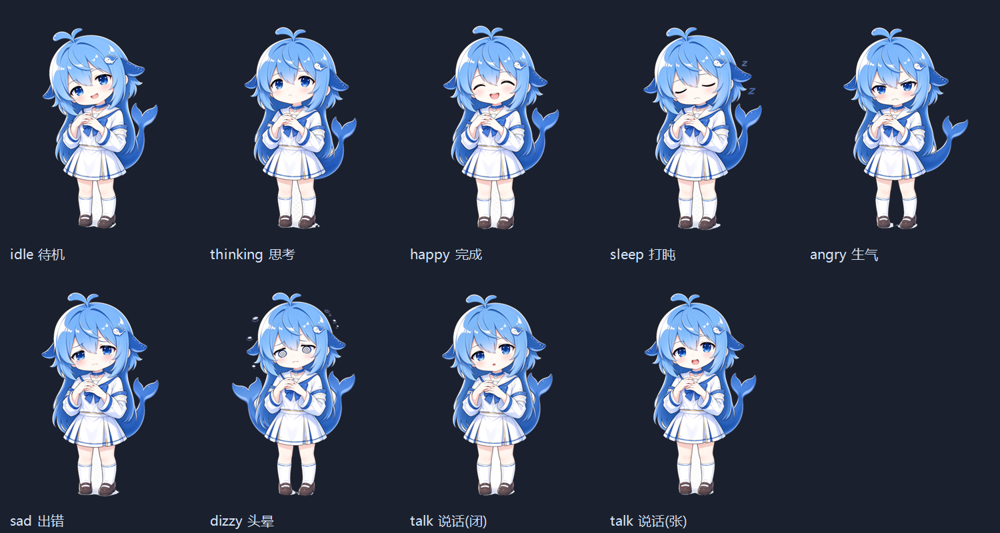

# dsh-whale-girl-plugin · DeepSeek 鲸鱼娘看板娘

给 DeepSeek Harness Web GUI 注入一只常驻的 **DeepSeek 鲸鱼娘**看板娘：透明立绘、待机动画、随 AI 状态切表情、会说话、可拖动，全部可配置。**纯注入、零侵入、免构建**。



## 特性

| 能力 | 说明 |
|------|------|
| **事件桥（v0.3）** | 直接订阅宿主 cordis 事件（`agent/status`、`agent/assistant-stream`、`tools/pre-execute`/`tools/result`、`agent/turn-stopping`、`agent/error`、`approval/request`、`user-questions/request`、`subagent/start|end`、`agent/inbox/*`），折成 10 个相位经 SSE 推给页面；**桥优先、DOM 传感兜底**，桥断流自动退回，面板可手动开关；`tool` 相位台词能点名工具（正在跑 pwsh 呢～） |
| 状态机（操作驱动） | 优先级：**操作瞬态（戳/拖/甩鼠标）> AI 瞬态（完成/出错）> AI 持续态（工作中/思考/等待输入）> 待机动态 > 打盹**；任何瞬态都有独立回落定时器，**到点必定回到当前真实状态**，绝不卡在某个表情上 |
| 待机动态 | 待机/等待输入/工作中都用 `idle.webm` 透明动画（视频不可用才退回 `idle.png` + 浮动）；**待机久了会自己玩**：每 16~34s 随机来一个小动作（瞟一眼/点头/摆尾/哼歌/伸懒腰/好奇"咦？"，快到入睡时间会打哈欠） |
| 说话口型 + 逐字气泡 | 气泡逐字显示（26 字/秒），口型同步开合，长句自动延长停留；**台词全部是角色口吻**（104 条：语气词、尾巴/深海/摸鱼梗、小傲娇），不念状态名、没有"现在是：XX"这类系统播报 |
| 9 种表情 | 待机 / 思考 / 完成 / 出错 / 生气 / 打盹 / 头晕 / 等待输入 + 说话口型，按 AI 实时状态与你的操作自动切换 |
| 交互分级 | 单击=按**点击位置**分区反应（摸头/戳身体/碰尾巴各说各的）+ 轻跳 → 连点 3 次="咦？" → 连点 5 次=生气；双击=逐个演示表情（限时自动回落，并说一句该情绪的台词） |
| 拖拽物理感 | 拖拽时按水平速度倾斜（≤7°）→ 松手**惯性滑动**一小段 + 落位小弹跳 + 位置记忆；贴到屏幕左右边缘会朝屏幕内**探头** |
| 贴边偷看会眨眼 | 拖到屏幕左/右边缘停留 2 秒就进入"扒墙偷看"保持态；**这张保持态是静帧，所以眼睛原本是死的** —— v0.15.0 起引擎每隔 2.2~6.2 秒把画面切成 `act-peek-03-blink.png`（闭眼帧）约 130ms，**就是一次真眨眼**，另外还有 ±2.4° 的慢速微摆，看起来和待机态一样"活着" |
| 鼠标逼近反应 | 快速把鼠标推到身上会"吓一跳"（后仰 + ？+ 台词，6s 冷却）；滚动页面时视线跟着内容走 |
| 音效（默认关） | WebAudio **合成音零素材**（单击/轻跳/完成/出错，指数包络防爆音）+ 可选待机 BGM（源 MP4 抽出的 `idle.ogg`）；全部**懒初始化 + 用户手势启动**，被自动播放策略挡下时静默等待；设置面板一键开关，隐藏时自动停 |
| 悬停反馈 | 鼠标移到角色身上轻微放大（1.03）并唤醒/恢复运动 |
| 感知 AI | MutationObserver 观察 dsh 的 `data-streaming` / `data-variant="think"[data-state]` / `[data-tool][data-state]` / `.turnErrorRow` / `[data-composer-input]:focus`；**错误行按"一次性事件（签名去重）"处理**，不会永久卡在难过表情 |
| 鼠标速度分档 | 慢=视线跟随；明显挥动=视线跟得更紧（不换脸）；**真的甩起来**（>5px/ms 且持续 420ms 且窗口内位移 >120px）才头晕，2.6s 后回待机 |
| 鼠标转速 → 头晕 | 三重门槛防误触发：阈值 5px/ms + 持续 420ms + 窗口位移 120px；旋涡眼 + 左右摇摆 + ☆ 粒子 + 台词；`behavior.dizzyMood` 可换成别的表情 |
| 连点 → 生气 | 4 秒内点 5 次 → 生气表情与台词，2.2s 后自动回待机 |
| 闲置打盹 | 10 分钟无操作（且 AI 空闲）→ 打哈欠铺垫 → 打盹 + **持续冒 Zzz + 可见呼吸**；任意交互唤醒 |
| 主题跟随 | 直接用 dsh 设计令牌 `--dsw-*`，深浅色与第三方主题自动一致；`.dgw-dark` 作为兜底 |
| 不吃点击 | 命中层按角色剪影 `clip-path` 裁切，透明留白处鼠标穿透到 dsh 界面 |
| 永不变死图 | 视频/立绘只用 opacity 叠层（不切 display）+ 1.5s 播放看门狗 + 有限重试；一次性动画后面串无限呼吸；减少动态效果时也保留极轻呼吸 |
| 源码热更新 | 改 `engine.mjs` / `mascot.config.mjs` / `character.mjs` **不用重启 dsh**：宿主每 2s 比对 mtime 自动重建注入片段，刷新页面即生效（写错语法时保留上一份可用片段并在日志告警） |
| 设置面板 | **表头可拖动、位置记忆、双击表头复位**；缩放 / 不透明度 / 自动说话 / 视线跟随 / 头晕 / 连点生气 / 待机动画 / 锁定位置 / 表情预览 / 位置重置，写入 localStorage |

## 安装

```powershell
# 在本机 dsh 的 profile 里安装（profile 名以实际为准，这里是 web）
dsh plugin --profile web add D:\dsh-code\whale-girl-plugin
# 安装后重启 dsh，并刷新一次浏览器页面（引擎在 index.html 渲染时注入）
```

## 自检

```powershell
# 1) 静态自检：注入片段语法、素材齐备、路径穿越防护、事件桥相位机、台词数据模型、清单一致性
node tools/check-inject.mjs

# 1b) 运行时冒烟：在 Node 里用最小浏览器桩真跑一遍引擎（启动/待机/情绪/气泡/事件桥/台词覆写/清理）
node tools/smoke-test.mjs

# 或者一把梭（静态 + 运行时）
npm test

# 2) 运行期自检：路由是否注册、素材是否能取到、注入片段是否非空、事件桥相位
curl http://127.0.0.1:3080/__mascot/status
# → {"activeWorkspace":"dsh-code",...,"diagnostics":{"version":"0.3.0","injectBytes":...,"needsRestart":[],
#      "bridge":{"phase":"idle","tool":null,"counters":{...}}}}

# 3) 事件桥实时流（不用浏览器就能看 AI 在干什么；发一条消息观察 thinking→working→tool→done）
curl -N http://127.0.0.1:3080/__mascot/events
```

想换语言：设置面板 →「台词语言」→ English（默认"自动"跟随界面语言）；想自己改台词：设置面板 →「台词（本地覆写）」；想加一门语言：往 `locale/` 放一个 `mascot.<lang>.json` 即可（键照抄中文池子）。

浏览器控制台调试钩子：

```js
window.__dshWhaleGirl.dump()            // 当前情绪/感知状态/设置/视觉/运动诊断
window.__dshWhaleGirl.motion()          // ★ 诊断"为什么不动"：shouldMove / video.paused / cssAnimation / reducedMotion …
window.__dshWhaleGirl.nudge()           // 强制把"该动的"拉回运动状态（唤醒 + 恢复播放 + 重同步）
window.__dshWhaleGirl.setMood('dizzy')  // 手动切表情（9 种 id，见 character.mjs）
window.__dshWhaleGirl.speak('测试')      // 手动说话（走气泡 + 口型）
window.__dshWhaleGirl.moods()           // 所有情绪 id
```

## 改完代码怎么生效

| 改动 | 生效方式 |
|------|----------|
| `mascot.config.mjs` / `character.mjs` / `engine.mjs` | **不用重启 dsh**：宿主每 2s 比对 mtime 自动重建注入片段，**刷新页面**即可（`/__mascot/status` 的 `diagnostics.hotReloads` 能看到重建次数） |
| `backend.mjs` / `index.js` / `package.json` | 重启 dsh（Host 侧模块换代）。改了但没重启时：`/__mascot/status` 的 `diagnostics.needsRestart` 会列出这两个文件，服务端日志也会提示一次 |
| `assets/`（素材） | 刷新页面即可；路由按 mtime 发 ETag，`?v=<版本>` 会随 `package.json` 版本号破缓存 |

> 为什么 HMR 不接管？dsh 的 HMR 默认忽略 `**/node_modules`（`packages/boot/hmr/src/index.ts:215`），而本插件是链接安装（`node_modules` 下的 junction），所以模块换代只能靠重启——这也正是这里自己做 mtime 轮询的原因。

## 配置

改 `mascot.config.mjs`（改配置不改引擎，改完刷新页面即可）：

| 字段 | 默认 | 说明 |
|------|------|------|
| `imgHeight` / `defaultScale` | 200 / 1.0 | 画布高度（3:4）与缩放；`minScale`~`maxScale` 可调 |
| `defaultPos` | 右下角 24/18 | 初始位置（px）；拖拽后以 localStorage 为准 |
| `idleMotion` | `'video'` | `'static'` 则只用静态待机图 + CSS 浮动 |
| `videoIdlePauseMs` | 8000 | 连续停在静态表情超过这么久就暂停视频省电（回到会动的情绪/看门狗会立刻恢复） |
| `videoRetries` | 3 | 待机动画加载/播放失败的自动重试次数（避免一次失败就永久静态） |
| `talkFps` | 5 | 口型基准帧率（实际帧间隔 ±30% 抖动） |
| `bubbleDurationMs` / `speakCoolDownMs` / `idleSpeakIntervalMs` | 4200 / 6000 / 45000 | 气泡停留、发言冷却、闲置发言间隔 |
| `followCursor` / `lookMaxOffset` / `lookSmooth` | true / 8 / 0.08 | 视线跟随开关与强度（v0.15.3 起设置面板暂不显示该开关，见下一行） |
| `showFollowCursorToggle` | false | 设置面板是否显示"视线跟随"开关。**默认隐藏**：真·眼珠跟随层已回滚，只剩很轻微的伪 3D 转头，留着容易被当成"点了没效果"；想临时验收改 `true` 即可（功能始终按 `followCursor` 生效） |
| `dizzy*` | 5 px/ms、420ms、120px、窗口 150ms | 头晕**三重门槛**：速度阈值 / 持续时长 / 窗口内最小位移（已调钝，防随手移动误触发）；想更敏感就把这三个数字调小 |
| `angry*` | 5 次 / 4000ms | 连点生气的触发条件 |
| `previewHoldMs` | 3000 | 双击/面板手动换表情的停留时长（到点自动回到真实状态） |
| `behavior.transientMs` | dizzy 2600 / angry 2200 / think 1300 / poke 800 | 各类"操作型"瞬态停留时长（到点必回真实状态） |
| `behavior.speedMood` | 3 档 | 鼠标速度（px/ms）分档：`≤2.6` 正常 / `≤5.0` 视线跟更紧（不换脸）/ 更快 → 头晕；`look` 是视线强度倍率，`mood` 是命中该档时的表情 |
| `behavior.dizzyMood` | `'dizzy'` | 头晕用哪个表情（想换成难过就填 `'error'`） |
| `behavior.idleMicroMinMs/MaxMs` | 16000 / 34000 | 待机小动作的随机间隔（`character.mjs` 的 `micro` 表就是待机时的"自娱自乐"动作库） |
| `behavior.hoverScale` / `dragTiltMaxDeg` / `dragSettleMs` | 1.03 / 7 / 460 | 悬停放大、拖拽最大倾斜角、落位回弹时长 |
| `behavior.typewriterCps` | 26 | 气泡逐字速度（字/秒），0 = 整句直接显示 |
| `behavior.clickThinkAt` / `clickAngryAt` | 3 / 5 | 连点第 N 次"咦？"，第 N 次生气 |
| `behavior.userTransientDuringWork` | true | AI 干活时用户操作是否也立刻有反馈（true = 操作优先、更跟手） |
| `idleToSleepAfterMs` | 10 分钟 | 闲置入睡阈值 |
| `sensors` | 见文件 | DOM 感知选择器（dsh 改版只改这里；感知不到只影响自动表情，不影响使用） |
| `hitPolygon` | 自动生成 | 角色剪影多边形，用于命中区域裁切 |
| `storageKey` | `dshWhaleGirl.settings` | localStorage 键名（存 `v` 版本号，缺字段用默认值合并） |

台词池在 `character.mjs`：每个情绪一个 `pool`，另有 `interact`（点击/拖拽）、`random`（彩蛋）、`time`（早安/午间/下午/夜间）、`context`（`{workspace}`）。

## 文件结构

```
whale-girl-plugin/
├─ index.js            Host 入口：tapIndex 注入 + 路由注册（effect 清理，热重载安全）
├─ backend.mjs         /__mascot/asset/<file>（白名单 + ETag/304 + Range 206）
│                      /__mascot/status（活跃 workspace + 自检信息）
├─ engine.mjs          前端引擎（IIFE 字符串）：状态机/口型/气泡/交互/感知/主题/设置
├─ character.mjs       角色层：9 种情绪的素材文件名、动画、口型开关、台词池
├─ mascot.config.mjs   配置中心（显示/发言/视线/头晕/生气/感知/主题/命中区域）
├─ assets/             运行期素材：9 张透明 PNG + 3 帧扒墙偷看 + 1 张闭眼帧 + idle.webm（共约 2.7MB）
├─ docs/preview.png    素材总览；docs/eye-life-preview.png / eye-life-realsize.png 是闭眼帧的目视验收图
├─ icon.png            插件图标（显示清单要求，≤256KiB）
├─ locale/{zh,en}.json 插件管理器里的标题与描述
├─ tools/
│   ├─ build-assets.ps1  素材流水线（从 source/ 原始素材重建 assets/）
│   ├─ import-actions.ps1 动作序列帧导入（多帧共用一个锚点，避免播放抖动）
│   ├─ build-eye-life.ps1 从保持态那一帧生成"闭眼帧"（贴边偷看眨眼用）
│   ├─ keytool.cs        抠图/对齐/剪影的 C# 实现（System.Drawing）
│   └─ check-inject.mjs  交付前自检
└─ cordis.patch.yml    bundle 层：声明插件 id
```

## 素材流水线

`source/` 里的原始素材是**不透明、棋盘格浅色背景**的 PNG（其中一个文件名是 `.jpeg`，实际内容是 PNG），所以必须先抠图，再统一基准对齐，表情切换才不会跳位：

```powershell
# 需要 ffmpeg（带 libvpx-vp9 才能编 alpha WebM）；没有 ffmpeg 时静态表情仍会重建，只跳过 idle.webm
powershell -NoProfile -ExecutionPolicy Bypass -File tools\build-assets.ps1 -Ffmpeg "C:\path\to\ffmpeg.exe"
```

流水线做的事：

1. **边界泛洪抠图**：从图像四边泛洪，把与边框连通的浅色背景（棋盘格 248/255）置为透明；角色内部的纯白（裙子、袜子）因为不与边框连通而被保留。边缘像素按亮度做柔和过渡，避免白边。
2. **统一基准对齐**：以 `主体.png` 前景包围盒的**底边中点**为锚点，角色身高统一为画布高度的 86%，所有表情与待机动画视频共用同一基准，切换时头脚不位移。
3. **待机动画**：`ffmpeg -vf fps=15` 抽帧 → 逐帧抠图 → `libvpx-vp9 -pix_fmt yuva420p -auto-alt-ref 0` 编成透明 WebM，并解码回一帧校验 alpha 真的存在。
4. **剪影多边形**：从 `idle.png` 的 alpha 质心向 28 个方向射线扫描，生成 `clip-path` 多边形，打印出来粘到 `mascot.config.mjs` 的 `hitPolygon`。
5. 顺带重建 `icon.png` 与 `docs/preview.png`。

**动作帧与"眨眼帧"**（`source/act-*/` → `assets/act-*`）：

```powershell
# 序列帧用同一套变换导入（各帧共用一个锚点，否则播放时会抖）
powershell -NoProfile -ExecutionPolicy Bypass -File tools\import-actions.ps1 -Id act-peek -SourceDir D:\dsh-code\source\act-peek
# 从"保持态停住的那一帧"生成闭眼帧（贴边偷看时眨眼看的就是它）+ 目视验收图 docs/eye-life-preview.png
powershell -NoProfile -ExecutionPolicy Bypass -File tools\build-eye-life.ps1
```

`build-eye-life.ps1` 做的是**像素手术**，不是重新出图：把 `act-peek-03.png` 里两只眼睛的**旋转椭圆**区域用"眼睛正上方的眼睑肤色"盖掉（逐列取色 + 平滑，头发像素单独保护不擦），
再按 `assets/sleep.png` 的闭眼画法补一条中间粗、两端收尖的眼线（同样按倾角旋转；画到独立图层再合成，**原图是头发的地方不画**，否则眼线会顺着眼角爬到发丝上）。
脚本顶部的 `$eyes` 表就是全部旋钮：`CX/CY`（中心）、`RX/RY`（长轴/短轴半径）、**`ROT`（眼睛的倾角）**。
> **`ROT` 别漏**：这张图是 3/4 侧脸 + 头是歪的，两只眼睛的长轴都朝右上斜约 **-17°**。眼线如果按水平画，眨眼那一瞬间会看到她"平着闭眼"，和身体的倾斜完全脱节（v0.15.1 修掉的实测问题）。
> 改完重跑，看 `docs/eye-life-preview.png`：红圈就是旋转后的填平范围，能直接看出有没有贴住斜着的眼睛。
> 更"正统"的做法是让模型多出一张闭眼帧（同姿势、同画布），做法见 `source/豆包素材生成需求.md` 的 **T5-b**：把它当作 `04.png` 放回 `source/act-peek/` 重跑 `import-actions.ps1`（四帧共用一套变换 → 不会错位），
> 再把 `character.mjs` 里 `peekEdge.eyeLife.blink` 指到 `act-peek-04.png` 就行 —— **引擎零改动**（`frames` 数组保持只有前三帧，开场轮播不会闪到闭眼）。

## 常见问题

- **看不到看板娘**：确认安装后刷新过页面；`curl /__mascot/status` 看 `diagnostics.injectHasEngine` 是否为 true；浏览器控制台是否有报错。
- **它变成一张不会动的图了**：控制台执行 `window.__dshWhaleGirl.motion()` 看卡在哪一步——
  - `shouldMove: false` → 当前情绪的静帧本来就该静止（思考/完成/出错/打盹/生气/头晕），或者正处于"等待输入"之外的真实状态；`nudge()` 可强制拉回；
  - `video.paused: true` 且 `shouldMove: true` → 自动播放被策略挡了，`nudge()` 或随便点一下页面即可恢复（看门狗 1.5s 内也会自己拉回）；
  - `reducedMotion: true` → 系统开了"减少动态效果"，此时**故意**只用静态立绘；在设置面板里也能自己确认。
- **只有静态图、完全不动**：`idle.webm` 没加载成功（控制台会有一条 warn）——检查 `/__mascot/asset/idle.webm` 是否 200；或在设置面板关掉"待机动画"。
- **表情不随 AI 状态变**：dsh 前端改版导致选择器失效，改 `mascot.config.mjs` 的 `sensors` 即可（`window.__dshWhaleGirl.dump()` 里的 `sensorMood` 能看到当前识别结果）。
- **挡住界面按钮**：拖动挪开，或右键 → 隐藏（`Alt+Shift+W` 唤回）；命中区域已按剪影裁切，透明处点击会穿透。
- **气泡太吵**：设置面板关掉"自动说话"，或调大 `speakCoolDownMs` / `idleSpeakIntervalMs`。

## 版本变更

**v0.15.4（闭眼帧跟上眼睛的倾角：不再是"平着闭眼"）**

| 项 | 说明 |
|----|------|
| 实测问题 | 贴边偷看时身体是斜的、两只眼睛的长轴也是斜的（3/4 侧脸 + 头歪，约 **-17°**），但合成出来的闭眼帧把两条眼线画成了**水平**——眨眼那一瞬间她的眼睛"平着闭上"，和身体倾斜完全脱节 |
| 几何改成旋转 | `build-eye-life.ps1` 里每只眼睛多了 `ROT`：填平用的椭圆、外圈清理、闭眼眼线**全部在"眼睛本地坐标系"（u 沿长轴、v 垂直长轴）里算再旋回画面**；椭圆半径按"睫毛上沿到卧蚕"的整段高度取（`RY` 15→19/20，中心沿 v 上移 3px），否则睫毛上沿会留成"第二道线" |
| 顺手修掉两个 | ① 眼线先画到独立图层再合成，**原图是头发的地方不画**（之前右侧眼线会顺着外眼角爬到发丝上）；② 外圈清理改成跟着椭圆旋转（半径 1.0~1.35 只擦深色/深蓝/纯白的眼睛像素），斜着眼睛的睫毛两端不再残留 |
| 工具旋钮 | 脚本顶部 `$eyes` 表 = `CX/CY/RX/RY/ROT`；`docs/eye-life-preview.png` 里的红圈是**旋转后**的填平范围，一眼就能看出有没有贴住斜着的眼睛 |
| 版本 | 素材文件名不变（`act-peek-03-blink.png`），但 `?v=` 从 0.15.3 → 0.15.4，避免浏览器沿用旧的一版帧 |

**v0.15.3（设置面板暂时隐藏「视线跟随」开关）**

| 项 | 说明 |
|----|------|
| 隐藏 | 设置面板里「视线跟随」那一行不再渲染（`mascot.config.mjs` 新增 `showFollowCursorToggle:false`，改 `true` 可临时放回） |
| 为什么 | 真·眼珠跟随层（v0.14.0）已在 v0.14.1 回滚，现在只剩很轻微的伪 3D 转头；留着开关容易被当成"点了没效果/坏了" |
| 没删功能 | `followCursor` 状态、持久化、`setState` 接口与 gaze 计算全部保留；`window.__dshWhaleGirl.setState({followCursor:false})`、配置或「完全静止」仍可关闭它，等眼珠跟随做好再把开关放出来 |
| 文档/测试 | README 配置表 + 开发文档 §11.1/§15.4 同步；静态门禁 +4 条（默认隐藏、行受开关控制、底层设置还在、注入配置真的带 false） |

**v0.15.2（按需求移除右键「换个表情」）**

| 项 | 说明 |
|----|------|
| 移除 | 右键菜单里的「换个表情」整项删掉；它专用的 `changeMoodSilently()`、`demoMood` 的 `silent` 参数与 `quietUntil` 闭嘴窗口也一并删干净，不留死代码 |
| 为什么 | 手动循环表情经常"点了像没反应"：从待机切到 `listening` 用的是同一张待机底图，第一下看不出变化；而且「换个表情」紧挨着「说句话」，很容易误点 |
| 现在菜单 | 说句话 / 设置面板 / 隐藏（换表情仍可双击循环，或设置面板的九宫格预览） |
| 测试 | 静态门禁改为断言"菜单里没有换个表情、也没有静默换脸残留代码"；运行时冒烟从"静默换脸 7 条 × 4 组"换成"右键菜单 6 条 × 4 组"：只剩 3 项、没有换个表情、其余项都在、说句话仍会开口、点完自动收起 |

**v0.15.1（右键「换个表情」只换脸，不说话）**

| 项 | 说明 |
|----|------|
| 现象 | 右键「换个表情」和「说句话」表现一样：换了表情还弹气泡说一句，两个菜单项分不清 |
| 修法 | 右键菜单改走 `changeMoodSilently()`：与双击同一套循环顺序，但 `demoMood(..., { silent:true })` 只换脸、不取台词；双击仍保留"换表情 + 说一句该情绪自己的台词"，面板九宫格预览也照旧 |
| 回落也不补话 | 新增 `quietUntil` 静默窗口（演示时长 + 1.2s）：`setMood` 的自动发言在窗口内一律让路。否则到点回落时 `setMood` 会顺手补一句待机台词，用户听到的还是"3 秒后它又说话了" |
| 测试 | 静态门禁 +7 条（菜单项接到静默换脸、不再复用双击、闭嘴窗口在、外链引擎路由指向当前模块）；运行时冒烟 +28 条（7 × 4 组：右键能开菜单 / 点完收起 / 换脸生效 / 不弹气泡 / 到点回落 / 回落不补话） |
| 顺带修的坑 | 外链形态（`/__mascot/engine.js`）原来渲染的是进程启动时 `import` 的那份 `engine.mjs`：改引擎后 `diagnostics.hotReloads` 在涨、页面刷新却还是旧代码。现在热更新成功后把 `activeEngine` 换成新 import 的模块，引擎路由现场渲染它 —— 以后改 `engine.mjs` 才是真的"刷新即生效"（**本次这个修复本身要重启一次 dsh**：`index.js` 属于宿主侧） |

**v0.15.0（贴边偷看时眼睛会动：眨眼帧 + 保持态微摆）**

| 项 | 说明 |
|----|------|
| 起因 | 贴到屏幕左右边缘进入"扒墙偷看"保持态后，画面停在 `act-peek-03.png` 这张**静帧**上，眼睛再也不动；而待机态用的是 `idle.webm`（眼珠逐帧在动），对比之下"贴边就是死的" |
| 眨眼 | 新增 `assets/act-peek-03-blink.png`（由 `tools/build-eye-life.ps1` 从第 3 帧生成，**同画布同对齐**），引擎在保持态里每 2.2~6.2 秒把它换上约 130ms —— 一次真眨眼；因为走的是既有"帧序列换 src"通道，**零新 DOM、零新 CSS、不可能错位** |
| 只在该帧眨 | 三个帧里眼睛位置不同（链式出图头部有位移），所以只在"停在基准帧"时换闭眼帧（`actFrameFile===el.base`），前两帧照常轮播 |
| 保持态微摆 | `pose.swayDeg/swayHz`：±2.4°、0.075Hz 的慢速左右摆（用挂钟时间而不是被钳成 1 的 `t`，否则摆动会僵住），头带着眼睛一直轻轻晃 |
| 配置 | `character.mjs` 的 `peekEdge.eyeLife = { base, blink, blinkMs, gapMs }`；素材不在/改名只会不眨眼，其余照常（可回退） |
| 可观测/可验收 | `motion().eye = { base, blinkFile, blinking, nextInMs, resting }`；`__dshWhaleGirl.blink()` 手动眨一次；`docs/eye-life-preview.png` 是"睁眼/闭眼"并排的目视验收图 |
| 测试 | 静态门禁 +17 条（配置/素材/路由/引擎守卫），运行时冒烟 +60 条（保持态才眨、手动眨、自动眨、眨完回睁眼、微摆真的在变、结束清状态） |

**v0.14.1（撤销 v0.14.0 的眼珠层）**

| 项 | 说明 |
|----|------|
| 撤销原因 | 真实页面里眼珠跟随没有生效，而且眼珠贴图按普通流排到了角色旁边（`position:absolute` 的包含块与假设不符） |
| 移除内容 | 引擎里的眼珠层代码、`gaze.eye` 配置、14 张 `base-/eye-` 素材、`tools/build-eye-layers.ps1`、两张预览图、以及静态/冒烟里 74 条相关断言（素材 27 → 13 个） |
| 保留内容 | v0.12.0 的**伪 3D 转头**（不依赖新素材，静态表情与待机视频都生效） |
| 测试教训 | 浏览器桩**没有布局能力**，只能验 transform/src/类名；"元素出现在屏幕哪里"必须靠真实页面验收——这条已写进开发文档 §22.5 |

**v0.14.0（视线阶段 2：真·眼珠跟着鼠标转）**

| 变化 | 说明 |
|------|------|
| 真·眼珠位移 | 新增眼珠图层：底图 `base-*.png` 把眼睛按同行两侧肤色填平，再叠 `eye-*.png` 眼珠贴图，按视线平移 **±8px（水平）/ ±3px（垂直）**——位移小于贴图 10px 边距，所以原位置的眼珠始终被盖住，**不会出现双影** |
| 闭眼自动排除 | `happy`（弯眼笑）与 `sleep`（闭眼）会自动关掉眼珠层，用原图，避免把眼睛"睁开" |
| 素材工序 | `tools/build-eye-layers.ps1` 生成 7 张睁眼素材的底图与贴图（idle/thinking/sad/angry/dizzy/talk-closed/talk-open），已接进 `build-assets.ps1`；`docs/eye-layer-preview.png` 是目视验收用的四联预览（原图/原位/右移/左移） |
| 分层说明 | 待机动画（视频）里眼珠逐帧变化、与静态图错位 37~47（实测），所以**视频状态用 v0.12 的转头，静态表情/口型帧用眼珠层**，两者互补 |
| 验证 | 静态门禁 +30 条（含 PNG 尺寸必须等于配置贴图区、闭眼排除项必须是真实素材）；运行时冒烟 304 → **348** 项（含"鼠标在右眼珠右移 / 在左左移 / 超上限钳制 / 闭眼表情自动关层"） |

**v0.12.0（视线/眼神跟随：从"整图平移"改成"转头看你"）**

**v0.13.1–0.13.5（T5 扒墙偷看接入：贴到边界就"摸墙偷看"）**

| 变化 | 说明 |
|------|------|
| 素材接入 | 新增 `tools/import-actions.ps1`：逐帧抠底 + **三帧共用同一套变换**（各算各的包围盒会让动作抖）；导入 `assets/act-peek-01..03.png` |
| 帧序列 | 动作表支持 `frames` / `frameMs`；动作期间画面由动作帧接管（不会被情绪贴图刷掉） |
| 贴边触发 | 拖到屏幕左/右边缘**停留 2 秒**即触发（不再等 45–120 秒随机调度）；换边算新一次到访 |
| **保持态** | 贴边偷看是**状态**而非定时动作：一直保持，直到 **点她 / 拖离边缘 / 隐藏** |
| **方向镜像** | 左边缘镜像、右边缘原图（素材朝向是屏幕外）——修正"左边缘朝左看" |
| 藏身与探头 | 45% 身体藏在边界外（只露一部分），叠加慢速往复探头（16px / 0.35Hz） |
| 不看 AI 状态 | `edgeIgnoreAiState`：贴到墙边就演，哪怕 AI 正在干活；贴边期间不触发其他闲时动作 |
| 结束条件修正 | `onUp` 绑在 document 上（页面任何地方松手），**不能**在那终止动作——曾经导致"没点到她也结束" |
| 测试 | 静态门禁 + 运行时冒烟 **304 项断言**（含"AI 干活仍触发""保持态不被打断""左右镜像正确""移离后结束"） |

**v0.13.0（休闲动作：动态待机动作，零素材版）**

| 变化 | 说明 |
|------|------|
| 闲时行为调度 | 每 45–120s 随机抽一个"休闲动作"播放（只在真待机时）；**按位置条件过滤 + 按权重抽签** |
| 把边界当墙 | `edgeState()` 判断贴住左/右/底边：贴边→**扒墙偷看**（朝屏幕内偏+倾斜+周期性探头），贴底→**趴着看**（下沉+摇摆+抬头） |
| 原地跑步 | 上下弹跳 + 左右交替微倾 + 音符粒子；贴边时自动让位给偷看 |
| 掏折扇煽风 | **已登记但等素材**（`needsArt: true`）：扇子是凭空多出来的物体，纯位图变换做不出来；素材到位后改一个字段即启用 |
| 姿态合成 | 与视线共用一个 transform 层（`.dgw-gaze`）：`translate → perspective → rotateY/rotateX → scale`；避免与浮动动画/拖拽倾斜互相覆盖 |
| 立刻让位 | 鼠标按下/抬键、切到工作/思考等状态、隐藏 → **硬中止 + 200ms 缓出**；「完全静止」/减少动态 → 拒绝启动 |
| 可观测 | `__dshWhaleGirl.act('jog')` 手动触发、`act()` 看当前、`stopAct()` 中止；`motion().act` 报告动作与贴边状态 |
| 测试 | 静态 +33 条，运行时冒烟 216 → **252** 项 |

**v0.12.0（视线/眼神跟随：从"整图平移"改成"转头看你"）**

**v0.12.0（视线/眼神跟随：从"整图平移"改成"转头看你"）**

| 变化 | 说明 |
|------|------|
| 伪 3D 转头 | 在"整体位移"和"浮动动画"之间新增 `.dgw-gaze` 图层，施加 `perspective(700px) rotateY(±7°) rotateX(±4°)`，`transform-origin` 放在**脖子**（58% 高度）→ 看起来是转头，而不是整张图挪动 |
| 方向映射 | `dx/(|dx|+k)` 饱和映射：鼠标离得再远也不会转过头；带平滑（0.18/帧）与"鼠标越快跟得越紧"的方向盘联动 |
| 该停时停 | 关掉「视线跟随」、系统减少动态效果、或开启「完全静止」时一律不转头 |
| 可观测 | `__dshWhaleGirl.motion().gaze` = `{ yaw, pitch, enabled }` |
| 覆盖范围 | **静态表情与待机视频都生效**（这是它优于"拆眼睛图层"的地方：视频里眼珠逐帧变化，拆不出来） |
| 测试 | 静态 +13 条（含"转头不许写在 anim 上"的架构断言），运行时冒烟 180 → **216** 项 |
| 没做的 | 真·眼珠位移（阶段 2）：探针实测两张思路都不可靠（暗像素分不出眼睛、亮块候选飘忽），需要带目视校验的图层工序，见开发文档第二十二节 |

**v0.11.1（右键菜单里的静音/开声也删掉）**

- 右键菜单少了「🔇 静音 / 🔊 开声」一项：它名字像音量控制，实际控制的是"要不要说话（气泡）"。音效整体移除后这一项容易误导，直接删掉
- 想让看板娘闭嘴仍然可以：设置面板 →「自动说话」取消勾选（持久化记忆），或调大 `speakCoolDownMs`
- 自检补 2 条：菜单里不含静音/开声、但「自动说话」开关仍在

**v0.11.0（按需求整体移除音效）**

| 变化 | 说明 |
|------|------|
| 移除音效 | 删掉设置面板的「音效」开关、WebAudio 合成音（click/hop/success/error）、待机 BGM 与 `idle.ogg` 素材；`sound` 配置段、音频状态字段、`motion().sound` 诊断一并清除 |
| 顺带收窄 | 素材放行扩展名从 `.png/.webm/.ogg/.mp3` 收回 `.png/.webm`；素材总量 2.01MB → 1.90MB |
| 自检反向锁死 | 新增 8 条断言确保"不会再长回来"：无音频代码、无面板开关、`sound` 配置段不存在、`idle.ogg` 已删且路由不放行 |

**v0.10.2（宿主重启后的真实运行验证 + 一个缓存 bug）**

| 变化 | 说明 |
|------|------|
| 实测结果 | 外链形态生效（index.html **97KB → 27KB**）、`/__mascot/engine.js` 200+ETag、`idle.ogg` 200、`/__mascot/events` 实测到真实相位（`phase=tool, tool=pwsh`） |
| 修掉一个真 bug | ETag 复验永远 200：宿主传进来的 `req` 不是 Node 的 `IncomingMessage`，`req.headers` 读不到 `if-none-match`。新增 `readIfNoneMatch()` 兼容 Node / koa / Express / Headers / `req.raw` 五种形态（静态自检 1328 → **1334** 条） |
| 注意 | 这是宿主侧修复，需**再重启一次** dsh 才生效（只影响缓存命中，不影响功能） |

**v0.10.1（情绪名也能跟语言走了）**

| 变化 | 说明 |
|------|------|
| 情绪名 i18n | 9 个情绪名（待机/等待输入/工作中/思考/完成/出错/生气/打盹/头晕）走 `moodLabel()`——面板九宫格、右键提示、`{state}` 插值一处生效 |
| 自检更严 | "用到必有译文"的校验扩到情绪名：漏一个就红（这轮正是它抓出 4 条漏译的 `ui:*`） |
| 测试 | 静态 **1328** 条 + 运行时冒烟 **180** 项，全绿 |

**v0.10.0（面板文案也能跟语言走了）**

| 变化 | 说明 |
|------|------|
| 面板文案 i18n | 设置面板 18 处标签（缩放/自动说话/事件桥/台词语言…）改走 `t('ui:*', 中文兜底)`，语言切成 English 时整块面板一起变英文 |
| 双向校验 | 自检断言"**用到的文案必有译文、译了没用的算问题**"——不会出现"改了中文忘了英文"或"英文包里有死条目" |
| 兜底不变 | `ui:*` 缺译文照样回落中文；本地覆写仍优先于语言包 |
| 测试 | 静态 **1323** 条 + 运行时冒烟 **180** 项，全绿 |

**v0.9.0（国际化：台词支持英文，可扩展任意语言）**

| 变化 | 说明 |
|------|------|
| 语言层 | 取台词时多插一层：**本地覆写 > 语言包 > 内置中文**；缺译文自动回落中文，永远不会哑巴 |
| 英文台词包 | `locale/mascot.en.json`：35 个池、120+ 句英文台词，键与中文严格一致；条件台词（语气梯度/夜间/回合数/周末）连条件一起保留 |
| 语言选择 | 设置面板新增「台词语言」：**自动**（跟随 `__DSH_LOCALE__` / 浏览器语言）/ 中文 / English；切换时当场用新语言说一句，改完即时生效并持久化 |
| 面板一致性 | 台词编辑器里显示的就是当前语言的文本（不会"面板中文、嘴上英文"） |
| 加语言 | 只需加一个 `locale/mascot.<lang>.json`，不用改引擎 |
| 测试 | 静态 526 → **1323** 条（逐句校验英文：无中文残留/长度/无播报腔 + 键双向对齐 + 条件一致），运行时冒烟 86 → **180** 项（inline/external × 中/英 4 组，含"删掉译文回落中文"） |

**v0.8.0（引擎改资产文件：index.html 从 ~85KB 降到 ~16KB）**

| 变化 | 说明 |
|------|------|
| 外链注入形态 | index.html 只留 `<style>` + 数据 `<script>` + `<script src="/__mascot/engine.js">`，**体积 −81%**；内联形态保留为兜底 |
| 引擎脚本路由 | 新增 `GET /__mascot/engine.js`：ETag 基于内容哈希 + `Cache-Control: no-cache`，内容没变返回 **304**（浏览器直接用缓存），热更新后自动取新版；只接受 GET/HEAD |
| 零白屏风险 | 只有**引擎路由注册成功后**才切外链；宿主侧没重启换代时继续用内联形态，绝不会出现"刷新后看板娘不见了" |
| 单一事实源 | 两种形态共用同一份引擎代码：`buildInject()` 填内联引导，`renderClientScript()` 填外链引导（`window.__DGW_DATA__`） |
| 测试 | 静态 506 → **526** 条（含外链形态 12 条），运行时冒烟 44 → **86** 项（inline + external 各跑一遍） |
| 顺带修掉 | 内联形态残留 `__DGW_CSS__` 占位符（静态断言抓到）；测试桩 `EventSource.instances` 跨轮复用导致 external 假故障 |

**v0.7.0（运行时冒烟测试：真跑引擎，并抓到真 bug）**

| 变化 | 说明 |
|------|------|
| 最小浏览器桩 | 新增 `tools/browser-stub.mjs`（零依赖）：元素/事件冒泡/`localStorage`/`MutationObserver`/`rAF`/**`EventSource` 可喂帧**/`AudioContext`/媒体 `play` 计数 |
| 运行时冒烟 | 新增 `tools/smoke-test.mjs`：用 `vm` **真正执行**注入的引擎，再通过 `window.__dshWhaleGirl` 驱动断言 **44 项**行为（启动/待机底图/情绪/气泡/事件桥/台词覆写/隐藏唤回/清理/无未捕获异常） |
| 双闸门禁 | `npm test` 与 `prepack` 现在都跑 `check-inject`（静态 506 条）+ `smoke-test`（运行时 44 条）；也可 `npm run smoke` 单跑 |
| 抓到并修掉 | **事件桥 SSE URL 拼错**：`/__mascot/asset/__mascot/events` → 正确应为 `/__mascot/events`。这会让事件桥重启后 404、永不生效，而语法/结构检查都发现不了；已修并补静态断言防回归 |

**v0.6.0（台词编辑面板：本地覆写）**

| 变化 | 说明 |
|------|------|
| 面板里改台词 | 设置面板新增折叠区「台词（本地覆写）」：选台词池 → 编辑（每行一句）→ **保存 / 恢复默认 / 复制 JSON**；保存后立即生效并记住 |
| 覆盖全部台词 | 14 处台词调用点统一走 `poolFor(key, pool)`：情绪台词、交互台词、点击分区、待机小动作、事件桥相位、时段问候、随机彩蛋都能改 |
| 条件台词只读 | 带 `when` 条件的台词在编辑器里以 `#（条件台词，不可在面板修改）` 显示，保存时自动忽略 |
| 净化与上限 | 去换行/去反引号/trim，单句截断 80 字、最多 40 行——粘贴长文不会撑爆气泡 |
| 独立存储 | `localStorage['dshWhaleGirl.settings.dialogue']`，与设置分开存；升级不覆盖你的改动 |
| 调试钩子 | `__dshWhaleGirl.dialogue()` 看全部覆写；`dialogue('mood:idle')` 读；`dialogue('mood:idle', ['句1','句2'])` 写；传 `null` 恢复默认 |
| 自检 489 → 505 条 | 覆写数据与净化上限、独立存储键、14 处 `poolFor` 覆盖、面板三按钮、条件只读、无裸反引号 |

**v0.5.0（对话系统：权重与条件 + 语气梯度；无障碍）**

| 变化 | 说明 |
|------|------|
| 台词条件 | 条目可写成 `{ line, weight, when }`；`when` 支持 `night` / `hourMin~hourMax` / `weekday` / `phase`（事件桥相位）/ `bridge` / `streak{key,min}` / `idleFor` / `minTurns` 九种键，**键名拼错会被自检当场拦下** |
| 条件优先、兜底不失语 | 命中条件的条目优先；一条都没命中就退回普通台词，**永远不会没话说** |
| 权重 | 先排除最近说过的，其余按 `weight` 加权随机；`dialogue.weights=false` 一键退化为等概率（排查"某句一直说"） |
| 语气梯度 | 连续同类事件计数（`streakResetMs` 内同类别累加）：首次报错安慰 → 第二次"又出错了" → 第三次"连着错好几次了，对不起嘛" |
| 语境化插值 | 新增 `{turn}`（回合数）与 `{streak}`（连续次数），配合既有的 `{tool}`/`{workspace}`/`{time}` |
| 键盘可达 | 角色可 `Tab` 聚焦：**回车/空格**说话、**方向键**挪位（8px 并记忆）、**H** 隐藏；焦点在输入框里只保留 H（绝不抢 dsh 的键） |
| 屏幕阅读器 | 气泡带 `role="status" aria-live="polite"`（自动说话打开时）；立绘/视频标记为装饰 |
| 完全静止模式 | `a11y.stillMode` + 设置面板开关：关掉全部关键帧动画与粒子（比 `prefers-reduced-motion` 的"极轻呼吸"更彻底） |
| 自检 292 → 489 条 | 逐条校验每句台词（非空/非 meta/≤40 字/条件键合法/权重为正），并**从产物里抽出 `whenOk` 与 `pickWeighted` 实测**：条件分支逐个断言边界，权重抽签 3000 次采样验证比例 |

**v0.4.0（交互与动态扩展 + 音效，默认关闭）**

| 变化 | 说明 |
|------|------|
| 点击分区反应 | `clickZone()` 按落点判头/身体/尾巴，从 `interact.zones.*` 取台词（摸头"会变笨的"，碰尾巴"很敏感的"） |
| 贴边探头 | 贴住视口左右边缘时朝屏幕内倾 7°；与拖拽倾斜共用**同一个** transform 通道，避免互相覆盖 |
| 惯性滑动 | 拖拽松手后按最后一帧速度滑 14 帧、每帧衰减 0.8，停稳才写位置 |
| 靠近吓一跳 | 进入 150px 且 200ms 内逼近 90px → 后仰 + ？+ 台词；6s 冷却、离开范围后重新武装 |
| 滚动视线 | 滚轮 `deltaY` 折算成视线偏移（钳在视口内），复用 rAF 注意力通道 |
| 音效（默认关） | click/hop/success/error 用 WebAudio 振荡器 + 指数包络**零素材**合成；BGM 用源 MP4 抽出的 `idle.ogg`；全部懒初始化 + 用户手势启动；`hide()` 停 BGM；设置面板开关即时生效并持久化；**默认必须关**这条写进了自检 |
| 素材放行规则 | 硬编码 10 个文件名 → 裸文件名 + 扩展名集合（`.png/.webm/.ogg/.mp3`）+ 解析后仍在 `assets/` 内（双保险）；加音效/皮肤不再需要改 Host 代码，`.js/.mjs/.cs/package.json` 仍被拒 |
| 自检 267 → 292 条 | 新增交互物理、音效默认关与音量合法性、音频懒初始化与包络、素材放行规则、`idle.ogg` 就位 |

**v0.3.0（事件桥：状态来源从"猜 DOM"换成"宿主告知"）**

| 变化 | 说明 |
|------|------|
| 宿主事件订阅 | 新增 `bridge.mjs`：订阅 12 个 cordis 事件并折成 10 个相位（idle/queued/thinking/working/tool/waiting/asking/helper/done/failed）；waterfall 事件只观察且**一律 `return next()`**，绝不打断 dsh 决策链 |
| SSE 推送 | 新增 `GET /__mascot/events`：首帧 `retry:` + 相位快照，之后变更即推；25s 保活；断开自动退订。`curl -N` 就能看 AI 在干什么 |
| 桥优先 / DOM 兜底 | 引擎 `effectiveSensor()` 统一出口：桥有帧用桥，超时（`staleMs` 8s）或断流自动退回 DOM 传感；桥新鲜时 DOM 逻辑直接跳过，两套逻辑不打架 |
| 语境化台词 | `tool` 相位台词支持 `{tool}`（"正在跑 pwsh 呢～"）；新增 queued/waiting/asking/helper/done/failed 六个相位的专属台词 |
| 可开关 + 可观测 | 设置面板加"事件桥（更准）"开关（持久化）；`motion().sense` 显示当前状态来源；`/__mascot/status` 的 `diagnostics.bridge` 给出相位与各事件命中次数 |
| 自检 193 → 267 条 | 新增相位归约（每条分支）、相位全集覆盖、SSE 帧协议、宿主订阅清单与 waterfall 交链、Host 三路由装配 |

**v0.2.4（台词二次元化）**

| 变化 | 说明 |
|------|------|
| 去掉状态报幕 | 双击/面板演示情绪不再念"现在是：完成"，改走 `demoMood()`：限时瞬态 + 说**该情绪自己的台词**（表情本身就是信息） |
| 台词全部重写 | 104 条按角色口吻重写：语气词（呀/啦/嘛/哦/诶/唔/哼/～）、角色化比喻（尾巴/深海/摸鱼/充电/token）、小傲娇与元气；每个情绪池 4~9 条，减少重复感 |
| 醒来台词 | 新增 `interact.wake`：从打盹醒来会说"唔……我睡着了吗？"，不再默默切回待机 |
| 去掉 `{state}` 插值 | 台词不再把状态名念出来；`context.workspace` 去掉反引号（气泡是纯文本） |
| 台词卫生自检 | 新增 21 条断言：禁止 meta 词、禁止 `{state}`、禁止反引号、单条 ≤40 字、每池 ≥4 条、注入脚本里不得出现报幕文本、不得把 label 当台词说出来（**以后想加台词，改 `character.mjs` 后跑 `npm test` 就能拦住回退**） |
| 后续清单 | 开发文档 §20.5.2 列了语境化台词（`{tool}`）、权重与条件、语气梯度、台词编辑面板、多语言 |

**v0.2.3（头晕调钝 + 面板可拖拽）**

| 变化 | 说明 |
|------|------|
| 头晕三重门槛 | 触发阈值 3.5 → **5.0 px/ms**；持续时长 260 → **420ms**；新增**窗口内累计位移 ≥120px**（原地小抖不算"甩"）；采样窗口 140→150ms、最少 4 个采样点；中间档视线加成 1.6→1.3 倍；恢复 600→800ms。已从"随手移动就晕"改为"真的要甩起来才晕" |
| 灵敏度下限断言 | 自检新增 4 条：头晕阈值 ≥4px/ms、持续 ≥350ms、最小位移 ≥80px、窗口 ≥120ms —— 防止以后被改回过于敏感 |
| 设置面板可拖拽 | 表头按住即可拖动（`⠿` 抓手 + `cursor:move`，点 × 不算拖拽）；位置写入 `localStorage` 并**记忆**；窗口缩放自动夹回可视区；**双击表头复位**到右下角 |
| 后续开发清单 | 开发文档新增第二十节（Backlog）：P0 事件桥、P1 更多动态与音效、P2 工程/无障碍/国际化、P3 大改方向 |

**v0.2.2（操作驱动的状态机 + 待机动态扩展）**

| 变化 | 说明 |
|------|------|
| 优先级模型明确化 | 操作瞬态 > AI 瞬态 > AI 持续态 > 待机动态 > 打盹；`behavior.userTransientDuringWork` 决定 AI 干活时操作是否也立刻有反馈 |
| 任何瞬态必回落 | 头晕/生气/"咦？"/轻跳都有独立回落定时器，到点回到**当前真实状态**（不是硬回 idle，AI 在干活就回到干活） |
| 待机不再"一模一样地循环" | 新增 `character.mjs` 的 `micro` 小动作库：瞟一眼/点头/摆尾/哼歌/看你写代码/伸懒腰/好奇；待机时每 16~34s 随机来一个，快到入睡时间会**打哈欠**铺垫 |
| 逐字气泡 + 同步口型 | 26 字/秒逐字显示，长句自动延长停留，比整句砸出来更像对话 |
| 点击分级 | 单击=说话+轻跳（**不换脸**，避免表情乱跳）→ 第 3 次="咦？" → 第 5 次=生气 |
| 鼠标速度分档 | `behavior.speedMood`：慢=跟随、快=跟得更紧（不换脸）、很快=头晕；头晕表情可用 `behavior.dizzyMood` 换 |
| 拖拽/悬停手感 | 拖拽按水平速度倾斜（≤7°）、松手回正 + 落位小弹跳；鼠标移到身上轻微放大 |
| 新增粒子 | ♪ 音符、♥、？、… 四类，待机小动作会用到 |

**v0.2.1（修复"动一下就变死图"）**

| 现象 | 根因 | 修法 |
|------|------|------|
| 说过话/碰过之后角色再也不动，像一张图 | 待机动画用 `display:none` 切换，Chromium 下视频层会脱离合成器并停在旧帧；`play()` 失败又被静默吞掉 | 视频与立绘**只切 opacity 叠层**，永不切 display；加 1.5s 看门狗自动 `play()`；连续失败降级为 `idle.png` + 浮动动画 |
| 说话时嘴动得太快、像抽搐 | 固定 8fps + 每帧重复 `img.src=同一 URL` 触发重新加载闪烁 | 基准降到 5fps 且帧间隔 ±30% 抖动；`src` 未变则不动；口型帧之间不淡入淡出 |
| 待机/等待输入时会切成静帧（看着像死了） | 这两个情绪映射到 `idle.png`，静帧叠加的浮动动画很微弱 | 给情绪加 `video: true`：中性嘴型的情绪永远用会动的底图 |
| 完成/生气/头晕等表情可能"卡住不走" | 回落定时器挂在 `setMood` 上，被后续 `setMood` 清掉后没人再 `refresh()` | 瞬态统一走 `flash()`：**无论中途发生什么，到点必有一次 `refresh()`** |
| 打盹看起来像一张静止图 | 静帧 + 极不明显的缩放 | 呼吸缩放/明暗起伏加大，并**持续循环冒 Zzz** |
| 双击/面板换了表情就一直是那个表情 | 直接 `setMood` 且没有回落 | 改为限时瞬态（`previewHoldMs`），到点回到真实状态 |
| 隐藏时气泡/口型还在后台跑 | `hide()` 只改了可见性 | 隐藏时一并收掉气泡、停口型、关菜单面板 |
| 修了 bug 却要重启 dsh 才生效 | 注入片段在模块加载时一次性生成 | 宿主每 2s 比对 `engine/config/character` 的 mtime 自动重建片段 |

## 许可与素材来源

插件代码 MIT。角色立绘与待机动画由用户提供（AI 生成素材，源 MP4 内含 AIGC 标注元数据），仅在本插件中分发使用。
